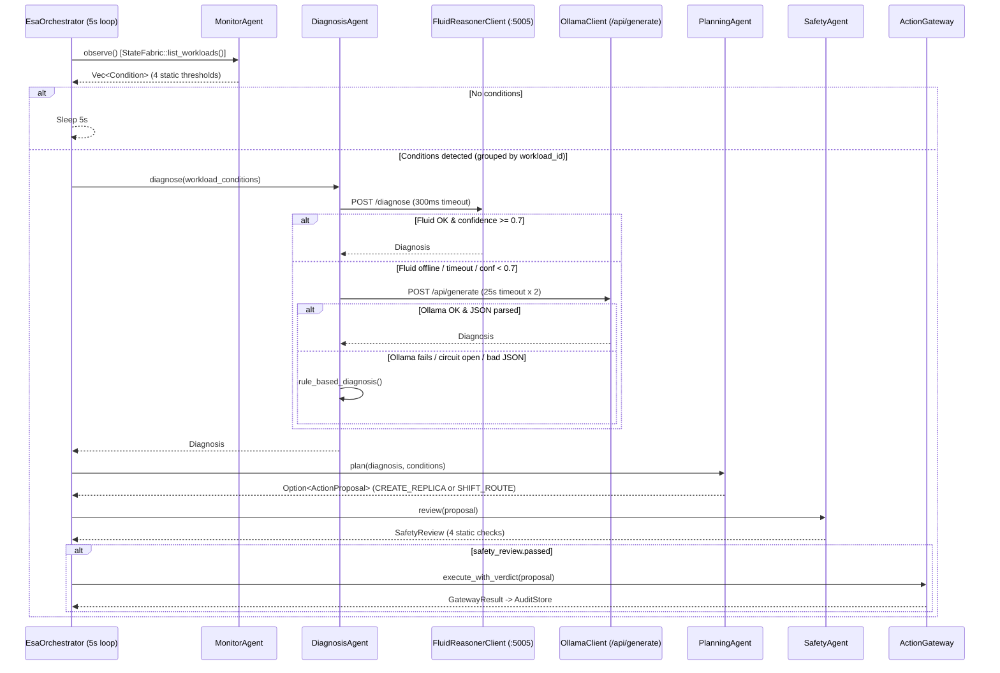

# ESAPay Current AI & Reasoning Architecture

**Audit Date:** 2026-11-12  
**Branch:** `main`  
**Purpose:** Ground-truth technical assessment of what is actually implemented in ESAPay's AI, reasoning, orchestration, memory, and evaluation subsystems versus what is only described in documentation.

---

## 1. End-to-End Agent & Inference Flow (As Implemented)

---

## 2. Detailed Audit of the 10 Required Areas

### 2.1 Existing Ollama Integration & Supported Request Formats
- **Location:** `crates/esa-agents/src/ollama.rs`
- **Classification:** **Implemented but insufficiently tested** (`TokenCounter` and `AICostTracker` have 8 unit tests; HTTP `/api/generate`, retry, semaphore, and circuit breaker have no automated tests).
- **Details:**
  - Calls `POST {base_url}/api/generate` with `OllamaRequest { model, prompt, stream: false, format: Some("json"), options: Some({ temperature: 0.1, top_p: 0.85, num_predict: 128 }), keep_alive }`.
  - Uses `reqwest::Client` with `connect_timeout(5s)` and `timeout(25s)`.
  - Concurrency capped via `tokio::sync::Semaphore::new(4)`.
  - Retries up to `max_attempts = 2` (with jittered backoff on HTTP `429`, 250ms sleep on transport error).
  - Circuit breaker trips for `30s` after `5` consecutive failures.
  - Exact-match in-memory response cache (`{model}:{agent_id}:{prompt.trim()}`) with `60s` TTL and `500`-entry clear-on-overflow cap.
  - **Gap:** Only supports Ollama's `/api/generate` JSON schema; no `/api/chat`, no streaming, no bearer auth header, no OpenAI-compatible or Gradio/ZeroGPU adapter.

### 2.2 Agent Communication & Orchestration
- **Location:** `crates/esa-runtime/src/orchestrator.rs`, `crates/esa-runtime/src/events.rs`
- **Classification:** **Implemented but insufficiently tested** (no tests in `crates/esa-runtime`).
- **Details:**
  - `EsaOrchestrator::run_forever(Duration::from_secs(5))` runs sequentially inside a single Tokio background task spawned in `esa-api/src/main.rs:700-706`.
  - Direct Rust method calls pass typed structs (`Condition` -> `Diagnosis` -> `ActionProposal` -> `SafetyReview` -> `GatewayResult`) in a fixed linear pipeline.
  - There is **no** inter-agent message bus, negotiation, debate, or multi-turn collaboration. `AgentRateLimiter::new(10)` (10 rps) paces `diagnose` calls per degraded workload.
  - `RuntimeEvent` callbacks forward updates to `TelemetryBroadcaster` (WebSocket) and `AgentStatusState`.

### 2.3 Existing Reasoning & Planning Capabilities
- **Location:** `crates/esa-agents/src/monitor.rs`, `diagnosis.rs`, `planning.rs`, `safety.rs`
- **Classification:** **Implemented but insufficiently tested**
- **Details:**
  - `MonitorAgent`: Deterministic threshold checks (`p95_latency_ms > 250.0`, `queue_depth > 1000`, `error_rate > 0.05`, `WorkloadState::Degraded | Overloaded`).
  - `DiagnosisAgent`: Only component that invokes an LLM. Sends serialized `Vec<Condition>` to Ollama requesting 1 of 5 `RootCause` enum values and `CREATE_REPLICA|SHIFT_ROUTE|null`. Includes defensive JSON fence stripping (`extract_json_object`) and field coercion (`normalize_root_cause_str`, `coerce_diagnosis_json_fields`).
  - `PlanningAgent`: **Does not use AI.** Deterministic `match` on `diagnosis.recommended_action` (`"CREATE_REPLICA"` or `"SHIFT_ROUTE"`), auto-switching `CREATE_REPLICA` to `SHIFT_ROUTE` when `current_replicas >= max_replicas`, using hardcoded `ExpectedEffect` deltas (`-80ms` / `-60ms` / `-40ms`).
  - `SafetyAgent`: **Does not use AI.** Runs 4 deterministic checks where `"Bounded action type"` and `"No shell/kubectl commands"` are hardcoded `passed: true`, checking only `rollback_enabled` and `!evidence_refs.is_empty()`.

### 2.4 Current Symbolic Reasoning in `arc_reasoner/`
- **Location:** `arc_reasoner/`
- **Classification:** **Partially implemented** (and **Documentation only** for payment-domain program synthesis claims).
- **Details:**
  - `arc_reasoner/engine.py` (`ARCReasoner`), `priors/`, `dsl/`, `synthesis/`, `exploration/` implement a genuine **2D integer grid ARC-task program synthesizer** (`recolor`, `crop_to_content`, `rotate_cw`, `fill_holes`, `apply_gravity`, `complete_symmetry`, bottom-up `ProgramSynthesizer` with MDL cost).
  - **Critical Discrepancy:** `docs/AGI_REASONER_ARCHITECTURE_AND_CONSTRUCTION.md` claims `arc_reasoner/dsl/primitives.py` contains `ShiftRoute`, `ScaleWorkload`, `FilterSeverity`, and `MapColor`, and that `esa_service.py` uses MDL program synthesis for payment resilience. In reality:
    - `arc_reasoner/dsl/primitives.py` contains **only visual ARC grid primitives** (zero payment/routing primitives).
    - `arc_reasoner/esa_service.py` (port `5005`) **never imports `ARCReasoner` or `ProgramSynthesizer`**. `induce_payment_diagnosis()` discretizes `[error_rate, p95_latency_ms, queue_depth]` into `0..3` integers and evaluates **4 hardcoded `if/elif` rules** (`HOT_PARTITION`, `TRAFFIC_SPIKE`, `NODE_DEGRADATION`, `CAPACITY_ISSUE`).
  - `arc_reasoner/chaos.py` implements `TelemetryChaosProxy` and `HysteresisFilter` (EMA + debounce window), used in `shadow_validator.py` (72-hour synthetic simulation), **not wired into Rust `MonitorAgent`**.

### 2.5 Existing Memory or Persistent Knowledge Mechanisms
- **Classification:** **Not implemented**
- **Details:**
  - No working memory across cycles, no episodic incident memory, no semantic knowledge base / vector store, and no procedural playbook store exist.
  - The only state retained across calls is: (a) `OllamaClient::response_cache` (60s TTL, cleared at >500 entries), (b) `AICostTracker::metrics` (in-memory `Vec` capped at 1,000 entries), and (c) `IntentManager` (in-memory `DashMap`). All are lost on restart.

### 2.6 Existing Model-Provider Abstraction
- **Classification:** **Not implemented**
- **Details:**
  - There is no trait or interface abstracting LLM providers. `DiagnosisAgent`, `EsaOrchestrator`, and `AppState` depend directly on the concrete `OllamaClient` struct.

### 2.7 Current Model Fallback & Failure Handling
- **Classification:** **Implemented but insufficiently tested**
- **Details:**
  - `DiagnosisAgent::diagnose` cascades: Tier 1 (`FluidReasonerClient`, 300ms timeout, requires `confidence >= 0.7`) -> Tier 2 (`OllamaClient`, 25s timeout × 2 attempts, 30s circuit breaker after 5 failures) -> Tier 3 (`rule_based_diagnosis`, deterministic).
  - **Gap vs Documentation:** `docs/AGI_REASONER_ARCHITECTURE_AND_CONSTRUCTION.md` describes a "Dual-Cadence Latency Contract" where Tier 1 (`>= 0.85`) and Tier 3 execute synchronously (<2ms) while Tier 2 Ollama runs **asynchronously in the background**. The actual code in `diagnosis.rs` runs Tier 2 **synchronously on the critical path** whenever Tier 1 is offline or `< 0.7`.

### 2.8 Existing Agent Evaluation & Benchmark Framework
- **Location:** `crates/esa-api/src/benchmark.rs`, `benchmark_harness.rs`, `adversarial_suite.rs`, `arc_reasoner/esa_rbench/`, `crates/esa-policy/src/safety_runner.rs`, `frontend/src/pages/BenchmarksView.tsx`
- **Classification:** **Partially implemented** (with significant **Mock / Documentation-only** gaps).
- **Details:**
  - **Real:** `adversarial_suite.rs` runs 650 real proposals against `ActionGateway` / `PolicyEngine` / `AuditStore` and verifies 0 unsafe mutations and valid SHA-256 chain. `benchmark_harness.rs` runs B0/B1/B2 against `StateFabric` across 5 seeds.
  - **Synthetic / Mocked:**
    - `benchmark.rs` uses hardcoded `detection_latency_ms` (`15000` for B0/B1, `250` for B2) and synthetic `stabilization_latency_ms` formulas; `run_esa_recovery_inner` also executes a hardcoded `CreateReplica` loop after `orchestrator.run_cycle()`.
    - `arc_reasoner/esa_rbench/runner.py` `run_ablations()` prints **hardcoded static numbers**; `baselines.py` `LLMOnlyController` and `UngatedToolLLMController` are **Python rule mocks** that never call an LLM.
    - `crates/esa-policy/src/safety_runner.rs` `SafetyTestRunner` sleeps 10ms and returns hardcoded `Pass`.
    - `frontend/src/pages/BenchmarksView.tsx` renders **100% hardcoded static metrics** and never fetches `/api/benchmark/latest` or `/api/benchmark/ablations`.

### 2.9 Existing Audit & Decision-Trace Capabilities
- **Location:** `crates/esa-core/src/audit.rs`, `crates/esa-gateway/src/executor.rs`, `crates/esa-api/src/main.rs`
- **Classification:** **Implemented and tested** (core hash chain), **Partially implemented** (agent reasoning trace & UI).
- **Details:**
  - `AuditStore` + `DecisionReplayer` provide tamper-evident SHA-256 hash-chaining and LLM-free deterministic replay (`crates/esa-core/tests/hash_chain_test.rs`, `tamper_detection_test.rs`).
  - **Gaps:**
    1. `ActionGateway::execute_with_verdict` initializes `AuditRecord` with an **empty** `AgentReasoningTrace` (`monitor_output: None`, `diagnosis_output: None`, etc.) and never populates it with the `DiagnosisAgent` or `SafetyAgent` outputs.
    2. `AuditStore` is in-memory only and wiped on restart.
    3. `/api/agents/status` (`main.rs:3969-4009`) returns **hardcoded template `transcript` strings** whenever `degraded_count > 0` rather than real agent traces.

### 2.10 Actual Learning or Model Adaptation
- **Classification:** **Not implemented**
- **Details:**
  - No fine-tuning, LoRA/QLoRA, RL, bandit routing, prompt optimization, or memory-driven adaptation occurs anywhere. Prompting Ollama with `Condition` JSON is stateless inference, not autonomous learning.

---

## 3. Summary Classification Matrix

| Capability | Classification |
|---|---|
| Cryptographic SHA-256 `AuditStore` & `DecisionReplayer` | Implemented and tested |
| Deterministic `PolicyEngine` & `ActionGateway` OCC | Implemented and tested |
| Adversarial 650-trial Safety Suite (`adversarial_suite.rs`) | Implemented and tested |
| `OllamaClient` + `AICostTracker` + Circuit Breaker + Semaphore | Implemented but insufficiently tested |
| 4-Agent `EsaOrchestrator` Pipeline | Implemented but insufficiently tested |
| `arc_reasoner` Symbolic Payment Reasoning (`esa_service.py`) | Partially implemented (4 `if/elif` rules; ARC solver unused) |
| `ESA-RBench` Ablations & LLM Baselines | Partially implemented (static ablation numbers; mock LLM baselines) |
| `AgentReasoningTrace` population in `AuditRecord` | Partially implemented (struct exists, left empty by `ActionGateway`) |
| `SafetyTestRunner` & `BenchmarksView.tsx` | Documentation only / Mock |
| Dual-Cadence Async Tier-2 Background Deliberation | Documentation only |
| Model-Provider Abstraction & Hugging Face ZeroGPU Client | Not implemented |
| Persistent Working / Episodic / Semantic / Procedural Memory | Not implemented |
| Controlled Learning / Calibration / Feedback Loop | Not implemented |

