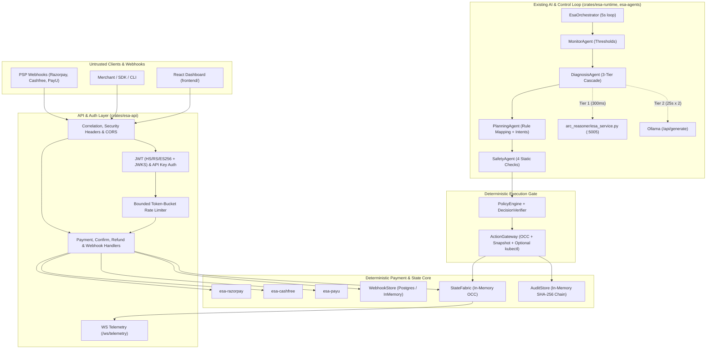

# ESAPay Phase 0 — Comprehensive Repository Audit

**Audit Date:** 2026-11-12  
**Target Repository:** `https://github.com/sujithputta02/Esapay`  
**Target Branch:** `main` (verified clean working tree with only untracked kickoff prompt files preserved)  
**Scope:** Read-only architectural, AI, payment-safety, and ZeroGPU-readiness audit. No source code, schemas, dependencies, or deployments were modified.

---

## 1. Executive Summary

ESAPay is a Rust-based multi-gateway payment orchestration and autonomous infrastructure resilience platform (**Executable State Architecture — ESA**). Its strongest engineering foundation lies in its **deterministic payment and safety core**:
- **Payment State Machine & Durable Webhook Store** (`crates/esa-core/src/payment_state.rs`, `crates/esa-state/src/webhook_store.rs`): Transactional PostgreSQL (`webhook_inbox`, `payment_records`, `payment_refunds`, `payment_attempts`) and matching in-memory store with advisory locks, idempotent deduplication, and atomic refund balance reservation.
- **Three Indian Payment Providers** (`crates/esa-razorpay`, `crates/esa-cashfree`, `crates/esa-payu`): Real cryptographic webhook signature/reverse-hash verification, server-to-server payment status verification, and circuit breakers (Cashfree & PayU).
- **Hardened API & Auth Layer** (`crates/esa-api/src/api_keys.rs`, `crates/esa-api/src/rate_limiter.rs`, `crates/esa-api/src/main.rs`): Cryptographic Supabase JWT verification (`HS256`/`RS256`/`ES256` + JWKS caching), SHA-256 hashed API keys, bounded keyed rate limiting, strict production fail-closed checks, and origin-allowlist CORS.
- **Deterministic Control Gate** (`crates/esa-policy`, `crates/esa-gateway`, `crates/esa-core/src/audit.rs`): Typed `ActionType` IR, `PolicyEngine` rules (`RULE_001`–`RULE_004` + `ConstraintValidator`), `DecisionVerifier`, commit-time Optimistic Concurrency Control (OCC), snapshot rollback, and SHA-256 hash-chained `AuditStore`.

By contrast, the **AI, reasoning, memory, and benchmarking layers** are significantly less mature than documentation claims:
- `HF_AI_BRAIN_URL` is configured in `.env.example` and `render.yaml`, and `deploy/huggingface-zerogpu/` contains a Gradio `app.py`, **but nothing in Rust consumes it**, and `deploy/huggingface-zerogpu/README.md` inaccurately documents Ollama-compatible `/api/generate` and `/api/tags` endpoints that `app.py` does not expose.
- `arc_reasoner/esa_service.py` (port `5005`) uses **4 hardcoded `if/elif` rules** on a discretized 0–3 severity grid rather than the `ARCReasoner` symbolic program synthesizer in `arc_reasoner/engine.py`.
- Several dashboard/benchmark surfaces (`frontend/src/pages/BenchmarksView.tsx`, `/api/intent/active`, `/api/intent/violations`, `SafetyTestRunner`, `arc_reasoner/esa_rbench/runner.py` ablations) return **hardcoded static data or mock passes**.
- `StateFabric` and `AuditStore` remain **in-memory only** (`crates/esa-state/src/store.rs` is disconnected from `esa-api`).

---

## 2. Current System Architecture

---

## 3. Repository Component Inventory & Implementation Classification

| Component / File | Role | Classification | Evidence & Notes |
|---|---|---|---|
| `crates/esa-core/src/payment_state.rs` | ISO-4217 currency registry, provider minimums, `PaymentState` FSM, refund state rules | **Implemented and tested** | 2,713 lines; strict minor-unit accounting and transition validation. |
| `crates/esa-core/src/audit.rs` | `AuditRecord`, SHA-256 hash-chained `AuditStore`, `DecisionReplayer` | **Implemented and tested** | Verified by `hash_chain_test.rs` & `tamper_detection_test.rs`; in-memory only. |
| `crates/esa-core/src/intent.rs` | `Intent`, `Constraints`, `IntentManager`, `ConstraintValidator` | **Implemented and tested** | Used by `PolicyEngine` and `PlanningAgent`; not exposed by `/api/intent/*` handlers. |
| `crates/esa-core/src/actions.rs` | Typed `ActionType` IR, `ActionProposal`, `ActionExecution`, `EffectMeasurement` | **Implemented and tested** | 6 bounded variants (`CreateReplica`, `ShiftRoute`, `MigratePartition`, `ThrottleWorkload`, `Rollback`, `RestartWorkload`). |
| `crates/esa-state/src/fabric.rs` | In-memory `StateFabric` with OCC version counter & snapshots | **Implemented and tested** | Tested in `fabric_test.rs`; ephemeral on restart. |
| `crates/esa-state/src/store.rs` | PostgreSQL `StateStore` (`workload_entities`, `payment_events`, `action_executions`, `audit_events`) | **Partially implemented** | Exists in `esa-state`, **never wired** into `esa-api`. |
| `crates/esa-state/src/webhook_store.rs` | Durable `PostgresWebhookStore` & `InMemoryWebhookStore` | **Implemented and tested** | 7,147 lines; 39 tests covering concurrency, advisory locks, refund reservations, reconciliation. |
| `crates/esa-policy/src/engine.rs` | `PolicyEngine` (`RULE_001`–`RULE_004`, `ConstraintValidator`, risk scoring) | **Implemented and tested** | Tested in `policy_test.rs` & `safety_tests.rs`. |
| `crates/esa-policy/src/verifier.rs` | `DecisionVerifier` (state version drift <= 5, workload existence) | **Implemented but insufficiently tested** | `verify_resource_limits` is a placeholder returning `Ok(())`. |
| `crates/esa-policy/src/safety_runner.rs` | `SafetyTestRunner` | **Documentation only / Mock** | `simulate_test_execution` sleeps 10ms and returns hardcoded `TestStatus::Pass`. |
| `crates/esa-gateway/src/executor.rs` | `ActionGateway` (policy, verifier, OCC, snapshot, simulated/k8s execution, audit) | **Implemented and tested** | `KUBERNETES_ENABLED` defaults to `false`; metric recovery uses `ExpectedEffect` formulas. |
| `crates/esa-runtime/src/orchestrator.rs` | `EsaOrchestrator` 5-second autonomous loop | **Implemented but insufficiently tested** | No dedicated unit/integration tests in `crates/esa-runtime`; `AgentReasoningTrace` not populated on `AuditRecord`. |
| `crates/esa-agents/src/ollama.rs` | `OllamaClient`, `TokenCounter`, `AICostTracker` | **Implemented but insufficiently tested** | Cost tracker has 8 unit tests; HTTP `/api/generate`, circuit breaker, and semaphore lack mock HTTP tests. |
| `crates/esa-agents/src/diagnosis.rs` | `DiagnosisAgent` 3-tier cascade | **Implemented but insufficiently tested** | Synchronous LLM call on Tier 2; no unit tests for `parse_diagnosis_response` or `rule_based_diagnosis`. |
| `crates/esa-agents/src/planning.rs` | `PlanningAgent` | **Implemented but insufficiently tested** | Deterministic mapping from `recommended_action` string; no LLM/optimization planning. |
| `crates/esa-agents/src/monitor.rs` | `MonitorAgent` | **Implemented but insufficiently tested** | Static thresholds (`p95 > 250ms`, `queue > 1000`, `error_rate > 5%`). |
| `crates/esa-agents/src/safety.rs` | `SafetyAgent` | **Implemented but insufficiently tested** | 4 static checks (`Bounded action type` & `No shell/kubectl` hardcoded `true`). |
| `crates/esa-agents/src/fluid_reasoner.rs` | `FluidReasonerClient` (HTTP `:5005`) | **Implemented but insufficiently tested** | 2 unit tests (1 panics in macOS sandbox due to `reqwest` proxy lookup). |
| `crates/esa-razorpay/` | Razorpay adapter, HTTP client, HMAC-SHA256 webhook, in-memory deduper | **Implemented and tested** | Missing API refund route in `esa-api`; `confirm` does not check `PaymentCaptured` vs `PaymentAuthorized`. |
| `crates/esa-cashfree/` | Cashfree provider, circuit breaker, HMAC-SHA256 base64 webhook | **Implemented and tested** | Circuit breaker unit test uses `reqwest` client construction. |
| `crates/esa-payu/` | PayU provider, SHA-512 forward/reverse/command hashes, circuit breaker | **Implemented and tested** | Webhook/callback verification and refund routes wired. |
| `crates/esa-telemetry/` | Prometheus `metrics` helpers | **Implemented but insufficiently tested** | 0 tests; defines 5 metric helpers. |
| `crates/esa-api/src/main.rs` | Axum server, auth, routing, checkout, webhooks, agents, benchmarks | **Implemented and tested** | Extensive integration tests (lines 6052–13755); `/api/intent/*` and `/api/agents/status` transcripts contain hardcoded responses. |
| `crates/esa-api/src/api_keys.rs` | Supabase JWT (`HS256`/`RS256`/`ES256` + JWKS), API key hashes, `SandboxKeyStore` | **Implemented and tested** | Fail-closed; production key checks via env hashes; sandbox keys durable in Postgres. |
| `arc_reasoner/` | Symbolic ARC-AGI grid solver + `esa_service.py` + `esa_rbench` | **Partially implemented** | ARC solver works on synthetic grids; `esa_service.py` uses 4 `if/elif` rules; `esa_rbench` ablations & LLM baselines are mocks. |
| `frontend/src/pages/BenchmarksView.tsx` | Benchmark & ESA-RBench dashboard | **Documentation only / Mock** | 100% hardcoded static JSX and JSON export; never queries `/api/benchmark/latest`. |
| `frontend/src/pages/AgentsView.tsx` | Agent status & AI thinking stream | **Partially implemented** | Calls `/api/agents/status` & `/api/agents/activity`, but falls back to hardcoded strings & static badges. |
| `frontend/src/pages/AuditView.tsx` | Action execution timeline | **Partially implemented** | Queries `/api/actions/recent`; does not use `/api/audit/verify-chain` or `/api/audit/replay/:id`. |
| `frontend/src/pages/PolicyView.tsx` | Policy verdict stats & rules | **Partially implemented** | Queries `/api/verdicts/recent` & `/api/verdicts/stats`; displays static rule descriptions (`RULE_001`–`RULE_003` mismatching backend `RULE_001`–`RULE_004`). |
| `frontend/src/pages/RuntimeView.tsx` | Live workload topology graph | **Implemented but insufficiently tested** | Queries `/api/workloads` & `/api/actions/recent`; regional pod badge uses hardcoded `count * 6`. |
| Model-Provider Abstraction | Unified LLM provider trait & router | **Not implemented** | `OllamaClient` is concrete and hardcoded across `esa-agents`, `esa-runtime`, `esa-api`. |
| Persistent Agent Memory | Working, episodic, semantic, procedural memory | **Not implemented** | Only 60s prompt cache and 1,000-entry metrics ring buffer exist. |
| Online Learning / Adaptation | Weight updates, prompt/policy adaptation from outcomes | **Not implemented** | Zero learning occurs anywhere in the codebase. |

---

## 4. Hugging Face ZeroGPU Integration Readiness

### 4.1 Current Configuration Audit

| Item | Location | Current State | Finding |
|---|---|---|---|
| `HF_AI_BRAIN_URL` | `.env.example:17`, `.env:17`, `render.yaml:13` | `https://sujithputta-esa-ai-brain.hf.space` | **Unused.** Zero references in `crates/` or `frontend/`. Exists only in env templates and `render.yaml`. |
| `HF_AI_BRAIN_TOKEN` | Not present anywhere | **Missing** | No token variable exists in `.env.example`, `render.yaml`, or Rust code for authenticating to a private HF Space. |
| `OLLAMA_URL` | `.env.example:13`, `crates/esa-api/src/main.rs:602`, `esa-benchmark.rs:33` | Defaults to `http://localhost:11434` | Consumed by `esa-api` and `esa-benchmark` to initialize `OllamaClient`. |
| `OLLAMA_MODEL` | `.env.example:14`, `render.yaml:15`, `main.rs:604` | Defaults to `mistral:latest` in Rust; `qwen2.5:0.5b` in `.env.example` / `render.yaml` | Inconsistency between Rust default (`mistral:latest`), `.env.example`/`render.yaml` (`qwen2.5:0.5b`), and `start-demo.sh` (`llama3.2:1b`). |
| `deploy/huggingface-zerogpu/` | `app.py`, `README.md`, `requirements.txt` | Gradio 5.20.0 app (`Qwen/Qwen2.5-0.5B-Instruct`, `@spaces.GPU(duration=60)`) | **Protocol mismatch:** `README.md` claims Ollama endpoints (`/api/generate`, `/api/chat`, `/api/tags`, `/health`), while `app.py` only launches a Gradio UI with `api_name="generate"`. |
| `deploy/huggingface-ollama/` | `Dockerfile`, `entrypoint.sh`, `README.md` | Docker Space running Ollama on port `7860` (`qwen2.5:0.5b`) | Separate CPU/Docker Space deployment; `scripts/deploy-hf-ollama.sh` suggests setting `OLLAMA_URL` to this Space. |
| `render.yaml` | Lines 13–16 | Sets `HF_AI_BRAIN_URL` and `OLLAMA_MODEL`, omits `OLLAMA_URL` | On Render free tier, `esa-api` falls back to `http://localhost:11434` (unreachable), so Tier 2 always fails over to Tier 3 rules. |

### 4.2 Answers to Readiness Questions

1. **Why `HF_AI_BRAIN_URL` exists and whether anything consumes it:** It was added to `.env.example` and `render.yaml` as a placeholder pointing to `https://sujithputta-esa-ai-brain.hf.space`, but **nothing in the Rust backend, Python service, or frontend reads or consumes it**.
2. **How Rust initializes Ollama:** In `crates/esa-api/src/main.rs:600-605`, `main()` reads `OLLAMA_URL` (default `http://localhost:11434`) and `OLLAMA_MODEL` (default `mistral:latest`), constructs a single `OllamaClient::new(...)`, passes a clone to `EsaOrchestrator::new(...)`, and stores another clone in `AppState` for metrics/cost endpoints.
3. **What is required to add a Hugging Face provider cleanly:**
   - Introduce an async `InferenceProvider` trait in `esa-agents` (or a new provider module) implemented by `OllamaProvider`, `HuggingFaceZeroGpuProvider`, and a composite `RoutedInferenceProvider`.
   - Align the ZeroGPU Space (`deploy/huggingface-zerogpu/app.py`) and Rust client on an explicit HTTP/JSON API contract (e.g., Gradio's `/gradio_api/call/generate` two-step SSE/POST protocol or a FastAPI/Gradio-mounted REST endpoint with `gr.mount_gradio_app`).
4. **How to keep Ollama as an alternative local provider:** Configure provider selection via `AI_PROVIDER=huggingface|ollama|auto|disabled` (defaulting cleanly based on configured env vars), keeping `OllamaClient` behind `InferenceProvider` so local `docker-compose.yml` and offline dev continue unchanged.
5. **How to support timeouts, inference queueing, and quota exhaustion:**
   - Hugging Face ZeroGPU dynamically attaches GPUs per `@spaces.GPU(duration=N)` call and enforces **daily GPU-time quotas** (PRO/Team/Free/Anonymous) plus **shared cluster queueing** when GPU slices are saturated.
   - The Rust client must enforce: (a) bounded concurrency (`Semaphore`), (b) separate connect/queue/total request timeouts, (c) explicit handling of HTTP `429` / `503` / Gradio queue-full / ZeroGPU quota-exhausted responses, (d) longer circuit-breaker cooldowns on quota exhaustion (e.g., 5–15 minutes rather than 30s), and (e) immediate fallback to local rules or Ollama.
6. **How to authenticate requests to a private Hugging Face Space:** Pass `Authorization: Bearer <HF_AI_BRAIN_TOKEN>` (a fine-grained HF access token with read access to the private Space) from the Rust backend only. Never use anonymous requests for private Spaces (HF returns `404`/`401`).
7. **How to avoid exposing Hugging Face tokens in the frontend:** Keep `HF_AI_BRAIN_TOKEN` strictly on the Rust backend (`esa-api`). Never prefix it with `VITE_`, never pass it in `/api/agents/*` responses, and never allow the browser to call `*.hf.space` directly.
8. **How to ensure inference failure never interrupts payment processing:**
   - Payment routes (`universal_checkout`, `*_webhook`, `*_confirm`, `*_verify`, `*_refunds`) **never** call `DiagnosisAgent`, `OllamaClient`, or `FluidReasonerClient` on the request path.
   - In `EsaOrchestrator::run_cycle()`, inference must be **non-blocking / bounded** (e.g., fast Tier 1/Tier 3 deterministic path for SLA-critical remediation, with LLM inference running in an isolated background task with strict timeouts and `catch_unwind`/error-to-fallback semantics) so a hung ZeroGPU queue never stalls `EsaOrchestrator` or starves Tokio worker threads.

---

## 5. Payment Infrastructure & Safety Audit

### 5.1 Lifecycle Verification Across Razorpay, Cashfree, and PayU

| Safety Property | Razorpay | Cashfree | PayU | Notes & Evidence |
|---|---|---|---|---|
| **Merchant Isolation** | Verified in `razorpay_confirm_payment` (`attempt.merchant_id == caller.merchant_id`) and `order.notes.esa_merchant_id`. | Verified in `cashfree_confirm_payment`, `cashfree_get_order`, `cashfree_create_refund`. | Verified in `payu_verify_payment`, `payu_create_refund`. | Admin callers (`caller.is_admin()`) bypass merchant check as intended. `payu_callback_handler` is an unauthenticated browser/PSP POST verified by reverse hash + `payment_attempts` lookup. |
| **Durable Payment Attempts** | `record_payment_attempt` called in `universal_checkout` and `razorpay_create_order`. | `record_payment_attempt` called in `universal_checkout`. | `record_payment_attempt` called in `universal_checkout`. | Stored in PostgreSQL `payment_attempts` (or `InMemoryWebhookStore` in dev). |
| **Authoritative Verification** | `razorpay_confirm_payment` fetches payment & order from Razorpay API; checks amount & currency match attempt. | `cashfree_confirm_payment` calls `provider.get_payment_status`; requires `Captured` + amount/currency match. | `payu_callback_handler` & `payu_verify_payment` call `provider.get_payment_status` (`verify_payment` PostService API). | **Gap in `razorpay_confirm_payment`:** `payment_entity_to_event` maps `"authorized"` to `PaymentAuthorized`, but `main.rs:2269-2295` unconditionally updates `payment_attempts` to `"captured"` and returns `"payment_state": "captured"`. |
| **Idempotency** | `webhook_inbox` `UNIQUE(provider, provider_event_id)` + `events_seen` + `confirm_{payment_id}`. | `webhook_inbox` `UNIQUE` + `cf_confirm_{order_id}`. | `webhook_inbox` `UNIQUE` + `payu_ver_{txnid}`. | Concurrent deliveries return `InFlight` (HTTP 409) via `FOR UPDATE` row locks. |
| **Atomic Refund Reservations** | **No HTTP refund endpoint** in `esa-api` (only webhook handling + `RazorpayAdapter::create_refund` trait method). | `cashfree_create_refund` calls `reserve_refund` (`FOR UPDATE` + pending sum check) before upstream call. | `payu_create_refund` calls `reserve_refund` (`FOR UPDATE` + pending sum check) before upstream call. | Timeout leaves reservation `pending` for reconciliation; non-timeout failure records `RefundFailed`. |
| **Unknown & Pending Outcomes** | `get_payment_status` maps unknown to `Unknown`; `payment_entity_to_event` rejects unknown with `UnsupportedStatus`. | `select_authoritative_cashfree_attempt` prioritizes `SUCCESS` -> `PENDING` -> latest; unknown -> `Unknown`. | `verify_payment` maps unknown -> `Unknown`; `parse_and_verify_callback` rejects unrecognized status. | Fail-closed: never promotes unknown/pending to captured. |
| **Webhook Verification** | Constant-time HMAC-SHA256 hex (`X-Razorpay-Signature`), 64 KiB body cap, dedicated `RAZORPAY_WEBHOOK_SECRET`. | Constant-time HMAC-SHA256 base64 (`x-webhook-signature` + `x-webhook-timestamp`), 1 MiB cap. | Constant-time SHA-512 reverse hash (`salt|status|...|key`), 1 MiB cap. | Note: PayU webhook/callback uses `merchant_salt` reverse hash without timestamp anti-replay window. |
| **Payment Event Processing** | `WebhookStore::process_webhook_event` -> `payment::apply_payment_event` -> `StateFabric` + WS broadcast. | Same pipeline. | Same pipeline. | Unapplied refunds arriving before capture are stored in `payment_refunds` (`applied_to_balance = false`) and reconciled on capture. |
| **Provider Routing & Failover** | `universal_checkout` evaluates `is_configured && is_healthy && supports_method && env_ok`, failing over Razorpay -> Cashfree -> PayU. | Same. | Same. | Routing is purely deterministic in `main.rs:5533-5786`; AI agents have zero role in per-transaction routing. |
| **Financial Audit Records** | `payment_attempts`, `payment_records`, `payment_refunds`, `webhook_inbox` in Postgres. | Same. | Same. | Infrastructure `AuditStore` is in-memory only and separate from financial ledger tables. |

### 5.2 AI Data Exposure Boundary

| Category | Safe to Expose to AI Agents | Must NEVER Enter Model Prompts / AI Memory |
|---|---|---|
| **Telemetry & Health** | Aggregated `p50`/`p95`/`p99` latency, `error_rate`, `queue_depth`, `rate_per_min`, `WorkloadState`, anonymized corridor/rail health (`razorpay`, `cashfree`, `payu`). | Raw cardholder data (PAN, CVV, expiry, cardholder name). |
| **Topology & Capacity** | `workload_id`, `region` (`IN-SOUTH`, etc.), `current_replicas`, `max_replicas`, `consistency_mode`, `state_version`. | API keys (`ESA_ADMIN_API_KEY`, `ESA_LIVE_API_KEY`, `RAZORPAY_KEY_SECRET`, `CASHFREE_CLIENT_SECRET`, `PAYU_MERCHANT_SALT`, `HF_AI_BRAIN_TOKEN`). |
| **Governance & Intents** | Active `IntentGoal` targets, `Constraints` bounds, anonymized `PolicyVerdict` counts, `EffectMeasurement` deltas. | Webhook secrets, JWT signing secrets, `Authorization` headers, Supabase tokens. |
| **Payment Domain (Future)** | Categorized error codes (`GATEWAY_TIMEOUT`, `UPSTREAM_5XX`), payment method class (`UPI`, `CARD`), currency code, bucketed amount tier. | Customer PII (`customer_email`, `customer_phone`, `customer_name`, IP address, VPA/UPI ID), raw PSP payloads, `merchant_id` across tenants. |

---

## 6. Authoritative Separation Principle

The deterministic Rust payment core (`esa-core`, `esa-state`, `esa-razorpay`, `esa-cashfree`, `esa-payu`), `PolicyEngine` (`crates/esa-policy`), and `ActionGateway` (`crates/esa-gateway`) **are and must remain the sole execution authority**. AI components may only emit bounded, schema-validated advisory outputs or typed `ActionProposal`s subject to deterministic policy, OCC, and human-approval gates.

