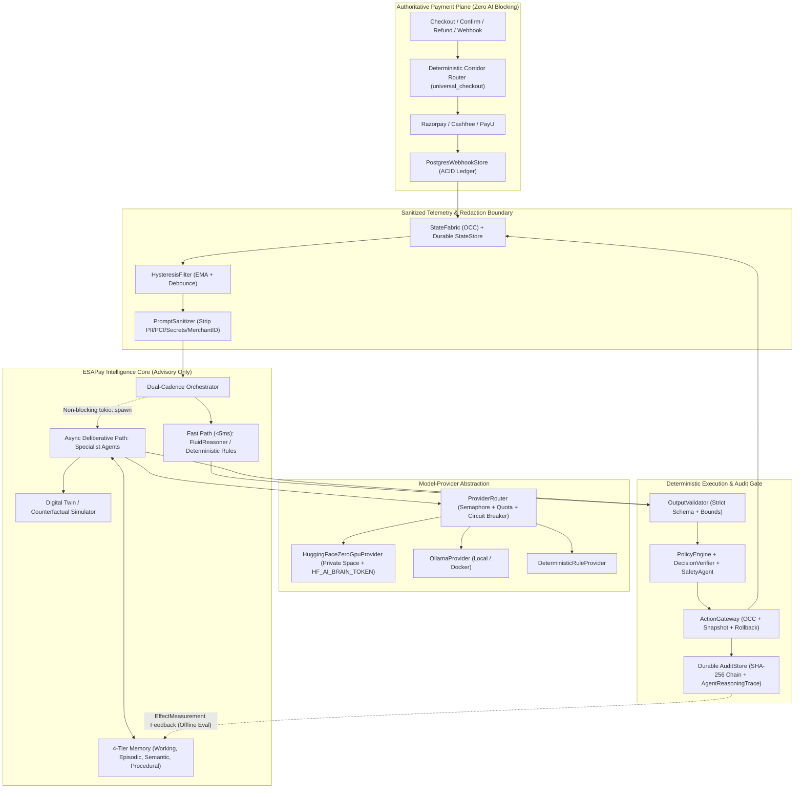

# ESAPay Target Intelligence Architecture

**Audit Date:** 2026-11-12  
**Target State:** Independent, Ethically Governed **ESAPay Intelligence Core** using Open-Weight Models & Hugging Face ZeroGPU  
**Guiding Principle:** Build on ESAPay's existing deterministic Rust payment core (`esa-core`, `esa-state`, `esa-policy`, `esa-gateway`). Do not rewrite what already works. Never allow AI to become an execution authority.

---

## 1. Architectural Separation: Exists Today vs. Must Be Built

| Layer | Exists Today (Reuse) | Must Be Built (New / Extended) |
|---|---|---|
| **Payment Core & Ledger** | `esa-razorpay`, `esa-cashfree`, `esa-payu`, `PaymentState`, `PostgresWebhookStore` | Razorpay HTTP refund route; `razorpay_confirm_payment` `Authorized` vs `Captured` fix |
| **Deterministic Gate** | `PolicyEngine`, `DecisionVerifier`, `ActionGateway`, `IntentManager`, `AuditStore` | Persist `AuditStore` & `StateFabric` via `StateStore`; populate `AgentReasoningTrace` |
| **Model Provider Layer** | `OllamaClient` (cache, semaphore, 30s circuit breaker, `AICostTracker`) | `InferenceProvider` trait, `HuggingFaceZeroGpuProvider`, `ProviderRouter` (quota/queue-aware), `HF_AI_BRAIN_TOKEN` auth |
| **ZeroGPU Space** | `deploy/huggingface-zerogpu/app.py` (Gradio + `@spaces.GPU`) | Align REST/Gradio API contract (`/health`, `/api/generate` or `/gradio_api/call/generate`), structured JSON schema, token auth |
| **Agent Orchestration** | `EsaOrchestrator` 5s loop, `MonitorAgent`, `DiagnosisAgent`, `PlanningAgent`, `SafetyAgent` | Async non-blocking Tier-2 deliberation, payment-domain specialist advisors (Corridor Advisor, Reconciliation Triage), `HysteresisFilter` in Rust |
| **Memory System** | None (60s prompt cache only) | 4-tier tenant-isolated memory in PostgreSQL (Working, Episodic, Semantic, Procedural) with schema validation & TTL/redaction |
| **Privacy & Ethics Guard** | `PaymentEvent::pseudonymous_reference` | `PromptSanitizer` (PII/PCI/secret redaction), `OutputValidator` (`deny_unknown_fields` + bounds), fairness/corridor bias monitor |
| **Evaluation & Digital Twin** | `adversarial_suite.rs`, `benchmark_harness.rs`, `arc_reasoner/esa_rbench/environment.py` | Live `BenchmarksView.tsx`, real LLM-backed `ESA-RBench` ablations, shadow dry-run counterfactual simulator |

---

## 2. Target System Architecture

---

## 3. Core Subsystem Designs

### 3.1 Model-Provider Abstraction & Hugging Face ZeroGPU Integration
- **Trait (`crates/esa-agents/src/provider.rs`):**
  - `async fn generate_structured(&self, req: InferenceRequest) -> Result<InferenceResponse, InferenceError>`
  - `async fn health(&self) -> ProviderHealthStatus`
  - `fn capabilities(&self) -> ProviderCapabilities`
- **Providers:**
  1. `HuggingFaceZeroGpuProvider`: Reads `HF_AI_BRAIN_URL` and `HF_AI_BRAIN_TOKEN` (backend-only). Supports Gradio 5 API (`/gradio_api/call/generate` POST + SSE result polling) or a FastAPI REST route mounted alongside Gradio in `deploy/huggingface-zerogpu/app.py`. Enforces separate connect (`5s`), queue (`15s`), and total (`45s`) timeouts. Maps HTTP `429` / ZeroGPU quota exhaustion to `InferenceError::QuotaExhausted { retry_after }`, tripping a longer cooldown (`300s–900s`) and immediately failing over to `OllamaProvider` or `DeterministicRuleProvider`.
  2. `OllamaProvider`: Wraps existing `OllamaClient` (`/api/generate`), preserving local/Docker/offline workflows.
  3. `ProviderRouter`: Selects primary/secondary providers via `AI_PROVIDER` (`auto` | `huggingface` | `ollama` | `rules`), enforces per-provider `Semaphore` concurrency limits, and records unified `AICostTracker` metrics (with prompts **redacted** before retention).

### 3.2 Dual-Cadence Specialist Agent Orchestration
- **Synchronous Critical Path (<5ms):** `MonitorAgent` (with Rust `HysteresisFilter` ported from `arc_reasoner/chaos.py`) -> Tier-1 `FluidReasonerClient` (if reachable & `conf >= 0.85`) or Tier-3 deterministic rules -> `PlanningAgent` -> `PolicyEngine` -> `ActionGateway`. Never blocks on ZeroGPU or Ollama.
- **Asynchronous Deliberative Path:** Spawns non-blocking tasks for open-weight LLM reasoning via `ProviderRouter`:
  - **Incident Diagnosis Specialist:** Root-cause analysis over redacted multi-corridor telemetry and episodic memory.
  - **Payment Corridor Advisor:** Evaluates PSP error-code clusters (e.g., bank-rail UPI timeouts vs compute saturation) and recommends advisory routing weight adjustments (applied only through typed `ActionProposal` + `PolicyEngine`).
  - **Reconciliation & Anomaly Triage Advisor:** Summarizes `unapplied` refunds or `PendingReconciliation` states for human operators (read-only advisory; zero mutation authority).
  - **Post-Incident Evaluator:** Compares `EffectMeasurement` (`expected` vs `observed`) after action execution to score diagnosis accuracy and write validated episodic records.

### 3.3 Persistent 4-Tier Memory Architecture (PostgreSQL)
All memory tables are strictly **schema-validated**, **merchant-isolated** (or global-anonymized for infrastructure telemetry), and **scrubbed of PII/PCI/secrets** prior to persistence:
1. **Working Memory (TTL: minutes, in-memory + Redis/Postgres):** Active incident context, recent `Condition` windows, `HysteresisFilter` EMA state, and in-flight proposal IDs.
2. **Episodic Memory (`ai_episodic_incidents`):** Past anomalies, diagnoses, `ActionProposal`s, `PolicyVerdict`s, and `EffectMeasurement` outcomes — enabling "similar past incident" retrieval without cross-merchant data leakage.
3. **Semantic Memory (`ai_semantic_knowledge`):** Curated payment-rail behavior profiles (e.g., PSP error code taxonomies, maintenance windows, currency/method rules) with optional `pgvector` embeddings.
4. **Procedural Memory (`ai_procedural_playbooks`):** Versioned, human-approved remediation templates and prompt-calibration rules. **Agents cannot self-modify procedural memory without human/admin approval and shadow-twin verification.**

### 3.4 Simulation & Digital Twin
- Unify `StateFabric` snapshots with `arc_reasoner/esa_rbench/environment.py` fault-injection models to provide a **Digital Twin Sandbox**:
  - Clones current `StateFabric` topology into an isolated in-memory twin.
  - Replays candidate `ActionProposal`s (or historical webhook/telemetry streams in `DRY_RUN` mode) to estimate blast radius before proposing high-risk actions.
  - Powers real (non-mocked) `ESA-RBench` runs and `SafetyTestRunner` assertions.

### 3.5 Controlled Learning & Evaluation
- **No online weight updates** in production.
- **Closed-loop calibration (offline/controlled):**
  1. `EffectMeasurement` outcomes feed into empirical calibration metrics (ECE, false-positive rate, SLA recovery delta).
  2. `BenchmarksView.tsx` and `/api/benchmark/*` display live, reproducible results from `benchmark_harness.rs` and `ESA-RBench`.
  3. Any prompt, threshold, or open-weight adapter update must pass `adversarial_suite.rs` (0 unsafe mutations) and `ESA-RBench` sealed holdout regression gates before promotion.

